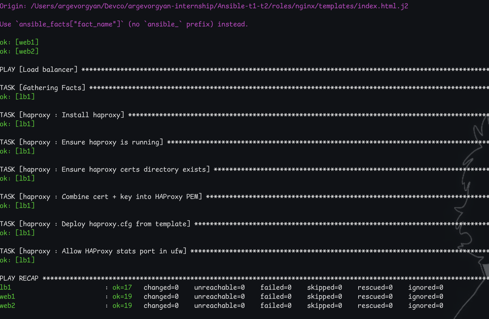
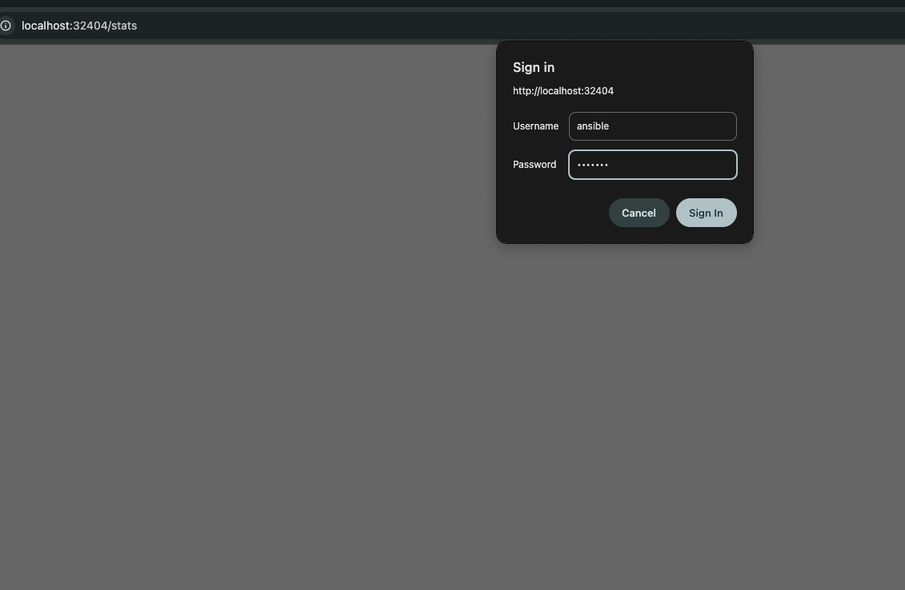
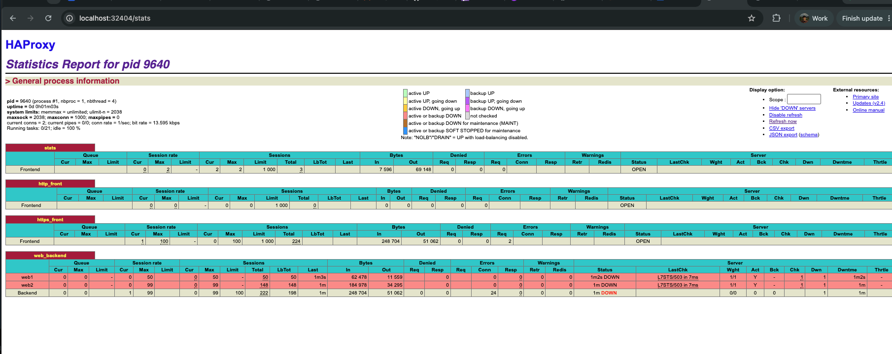
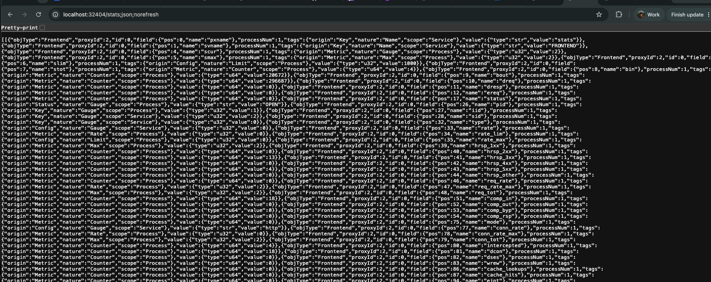

# Ansible — Nginx + HAProxy

Two Nginx web servers behind an HAProxy load balancer, deployed with Ansible. Three environments (dev/staging/prod), secrets in Ansible Vault, self-signed SSL, UFW firewall rules.

For local testing the "servers" are Docker containers with SSH enabled.

## Layout

```
vars.yml                        # single source of truth for all non-secret vars
group_vars/all/vault.yml        # encrypted secrets (HAProxy stats password, DB creds)
inventory/
  dev/hosts.ini                 # 2 web + 1 lb, SSH to localhost ports
  staging/hosts.ini             # 3 web + 1 lb
  production/hosts.ini          # 4 web + 1 lb
  */group_vars/all.yml          # env-specific tuning (worker count, server_name, etc.)
roles/
  common/   — apt packages, UFW rules, self-signed SSL cert
  nginx/    — install, configure, custom vhost + index page
  haproxy/  — install, configure with backend list from inventory
```

## Infrastructure

```
        Internet
            │
       :80 / :443
            │
      ┌─────▼──────┐
      │   HAProxy  │   :8404/stats  ← password from Vault
      │   (lb1)    │
      └──┬─────┬───┘
         │     │   balance: roundrobin (dev) / leastconn (prod)
    ┌────▼─┐ ┌─▼────┐
    │ web1 │ │ web2 │   Nginx on :443, health at /health
    └──────┘ └──────┘
```

## Variables

All shared variables live in `vars.yml` at the root. Environment-specific overrides go in `inventory/<env>/group_vars/all.yml`. Secrets are in `group_vars/all/vault.yml` (Ansible Vault encrypted).

```
vars.yml               → app_name, ssl paths, nginx log paths, timezone, etc.
vault.yml              → vault_haproxy_stats_password, vault_db_password
inventory/dev/...      → nginx_worker_processes: 2, haproxy_balance: roundrobin
inventory/prod/...     → nginx_worker_processes: auto, haproxy_balance: leastconn
```

## Quick start (local Docker)

```bash
# 1. Build and start containers
docker-compose up -d --build

# 2. Create vault password file
echo "YourVaultPass" > .vault_pass

# 3. Encrypt secrets
ansible-vault encrypt group_vars/all/vault.yml --vault-password-file .vault_pass

# 4. Run
ansible-playbook site.yml -i inventory/dev/hosts.ini --vault-password-file .vault_pass
```

Verify it works:
```bash
# Custom HTML page served by web1
curl -k https://localhost:32444

# Load balancer (hits web1 or web2 on each request)
curl -k https://localhost:32443

# HAProxy stats (admin / password from vault)
open http://localhost:32404/stats
```

## Deploy to real hosts

Update the IPs in `inventory/<env>/hosts.ini`, then:

```bash
ansible-playbook site.yml -i inventory/staging/hosts.ini --vault-password-file .vault_pass
```

## Validate

```bash
ansible-playbook validate.yml -i inventory/dev/hosts.ini --vault-password-file .vault_pass
```

Checks nginx and haproxy are running, HTTP redirects to HTTPS, `/health` returns 200, stats page is reachable.

---

## Screenshots









---

## Issues hit during setup

**`stdout_callback = yaml` broke on newer Ansible**
community.general removed the yaml callback plugin in v12. Fix: switch to `stdout_callback = default` + `result_format = yaml` in `ansible.cfg`.

**`python3-openssl` / `python3-cryptography` not found in container**
The Docker image is minimal — those packages don't exist in its apt sources without a proper mirror. Switched SSL cert generation to plain `openssl req` CLI command instead of the `community.crypto` module.

**`timedatectl` fails in containers**
Containers don't run systemd so `timedatectl` can't connect to DBus. Just write the timezone string to `/etc/timezone` directly with the `copy` module.

**UFW fails in containers**
Same reason — no systemd init. Added `ignore_errors: true` on all UFW tasks so the playbook continues; on real VMs these tasks work fine.

**HAProxy reload binds to already-used ports**
When haproxy is already running and holds :80/:443, a naive `systemctl reload` tries to bind fresh sockets and fails. Without systemd in the container, the service module can't do a graceful reload either. Fixed by using `service haproxy restart` via shell in the handler — stops the old process first, then starts fresh.

**HAProxy config validation failed — missing PEM**
HAProxy needs a combined cert+key PEM at `/etc/haproxy/certs/boutique.pem` but we only generated separate `.crt` and `.key` files. Added a task that concatenates them: `cat boutique.crt boutique.key > boutique.pem`.

**`option httpchk` deprecation warning → validation error**
The old syntax `option httpchk GET /health HTTP/1.1\r\nHost:\ localhost` is deprecated in HAProxy 2.4 and causes a parse error in strict mode. Updated to the new form: `http-check send meth GET uri /health ver HTTP/1.1 hdr Host localhost`.
