# Dockert1-t2: Containers, GKE and Helm

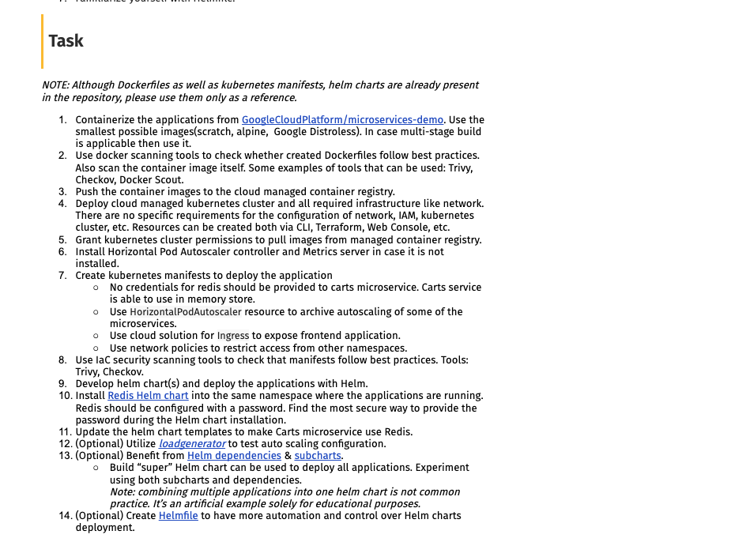

I took 5 services from GoogleCloudPlatform/microservices-demo (`frontend`, `productcatalogservice`, `cartservice`, `currencyservice`, `shippingservice`), containerized them, scanned them, pushed them to Artifact Registry and ran them on GKE: first with plain manifests, then with a Helm chart plus Redis. That is enough for a working catalog and cart page. I skipped the optional parts (load test, subcharts, Helmfile).

Everything I created is named `ar-...` so it's easy to clean up. Project `gd-gcp-gridu-devops-t1-t2`, region `europe-west1`, registry `ar-registry`, cluster `ar-cluster`, namespace `ar-app`.

## 1. Dockerfiles

All multi-stage: build in a full image, run in a tiny one.

| Service | Runtime image | Runs as |
|---------|---------------|---------|
| frontend, productcatalogservice, shippingservice (Go) | `distroless/static:nonroot` | 65532 |
| cartservice (.NET) | `runtime-deps:noble-chiseled` (Microsoft's distroless) | 10001 |
| currencyservice (Node) | `alpine` + `nodejs` only | 10001 |

The Go ones look like this:

```dockerfile
FROM --platform=$BUILDPLATFORM golang:1.27-alpine AS builder   # build stage
RUN go mod download                                            # deps in their own cached layer
RUN go get golang.org/x/net@v0.62.0                            # fixes 2 CVEs Trivy found
RUN CGO_ENABLED=0 GOOS=linux GOARCH=amd64 go build ...         # static binary for GKE
FROM gcr.io/distroless/static-debian12:nonroot                 # runtime: no shell, no package manager
COPY --from=builder ...                                        # only what the app needs
USER nonroot:nonroot
```

Things that bit me:
- Distroless has nothing but what you copy, so `frontend` needs `templates/` and `static/` copied in, and `productcatalogservice` needs `products.json`.
- I'm on an arm64 Mac and GKE is amd64, so images are built with `docker buildx build --platform linux/amd64 ... --push`.
- The .NET SDK crashed under emulation (MSB4184). `DOTNET_EnableWriteXorExecute=0` in the build stage fixed it.

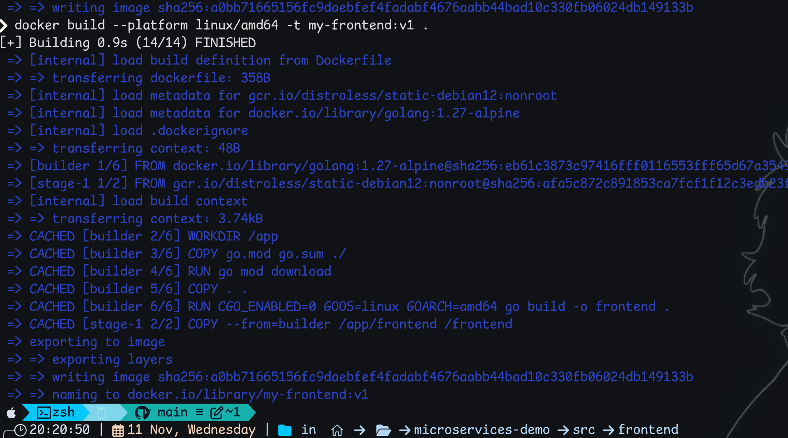

## 2. Scanning

- **Checkov** (Dockerfiles): added `USER` where it was missing. The HEALTHCHECK rule is skipped on purpose, since distroless has no shell or curl and Kubernetes probes do that job.
- **Trivy** (images): found 2 HIGH CVEs in `golang.org/x/net`. Bumped it, rebuilt, clean.

```bash
checkov -f Dockerfile --framework dockerfile
trivy image --severity HIGH,CRITICAL <image>
```

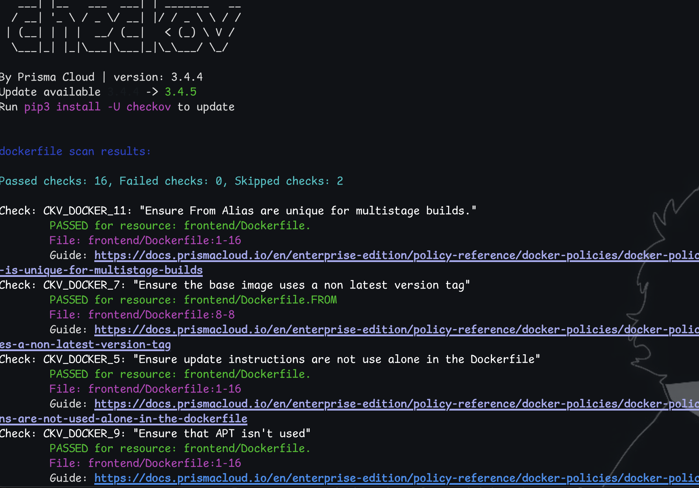
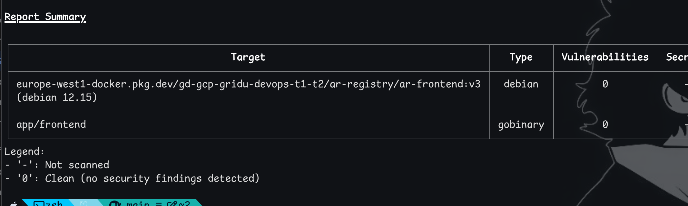
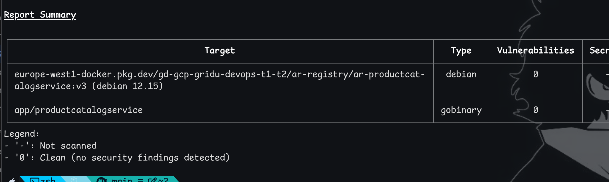

## 3. Registry and cluster

```bash
gcloud artifacts repositories create ar-registry --repository-format=docker --location=europe-west1
gcloud auth configure-docker europe-west1-docker.pkg.dev
```

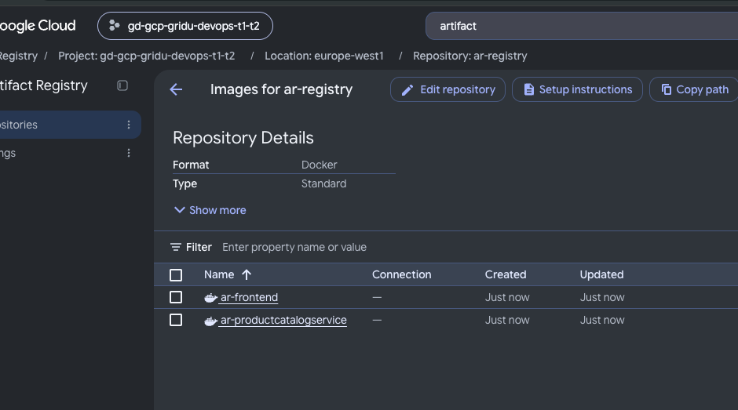

The project was out of VPC quota, so I created the cluster in the console on the existing `default` network (2 x e2-standard-2, network policy on). Nodes use the default service account, which can already pull from Artifact Registry in the same project. Metrics Server and the HPA controller come with GKE, `kubectl top nodes` works out of the box.

```bash
gcloud container clusters get-credentials ar-cluster --zone=europe-west1-b
```

## 4. Plain manifests (`k8s/`)

Deployments and Services for each app (non-root, read-only filesystem, no capabilities, no service account token, resource requests, probes), an HPA on CPU 50%, a GKE Ingress, and NetworkPolicies that only allow traffic from inside `ar-app`.

In this step cartservice gets **no Redis settings at all**, so it falls back to its in-memory store:

```
Redis cache host(hostname+port) was not specified. Starting a cart service using in memory store
```

```bash
kubectl apply -f k8s/
kubectl get pods,svc,hpa,ingress -n ar-app
```

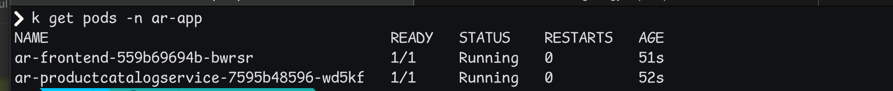
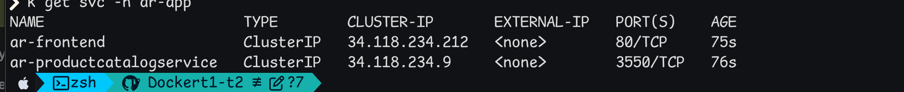
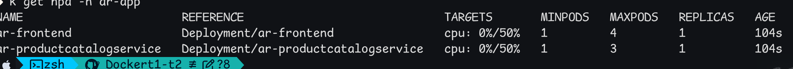

Trivy and Checkov on the manifests: fixed pull policy, high UID, and the service account token. Two documented skips: image digest (tags are pinned instead) and Trivy's "untrusted registry" (it's our own Artifact Registry).

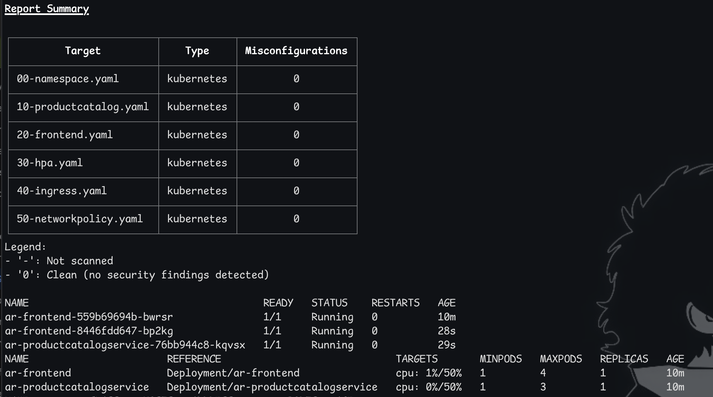

## 5. Helm and Redis

One chart, `helm/ar-app`, which renders a Deployment, Service and HPA for each service in `values.yaml`, plus the Ingress and NetworkPolicies. Redis (Bitnami) is a separate release in the same namespace.

The Redis password is never typed on a command line or written in a file: it's generated straight into a Secret, and both Redis and cartservice read it from there. The Redis image is pinned by digest instead of the rolling `latest` tag.

```bash
kubectl create secret generic ar-redis-secret -n ar-app --from-literal=redis-password="$(openssl rand -base64 24)"

helm repo add bitnami https://charts.bitnami.com/bitnami
helm install ar-redis bitnami/redis -n ar-app -f helm/redis-values.yaml
# then pin the digest of the image that is running
helm upgrade ar-redis bitnami/redis -n ar-app -f helm/redis-values.yaml \
  --set image.digest="$(kubectl get pod ar-redis-master-0 -n ar-app -o jsonpath='{.status.containerStatuses[0].imageID}' | sed 's/.*@//')"

cd helm
helm lint ar-app
helm install ar-app ./ar-app -n ar-app      # later: helm upgrade ar-app ./ar-app -n ar-app
```

The chart points cartservice at Redis (this is the "update the templates" step):

```yaml
- name: REDIS_PASSWORD
  valueFrom: {secretKeyRef: {name: ar-redis-secret, key: redis-password}}
- name: REDIS_ADDR
  value: "ar-redis-master:6379,password=$(REDIS_PASSWORD)"
```

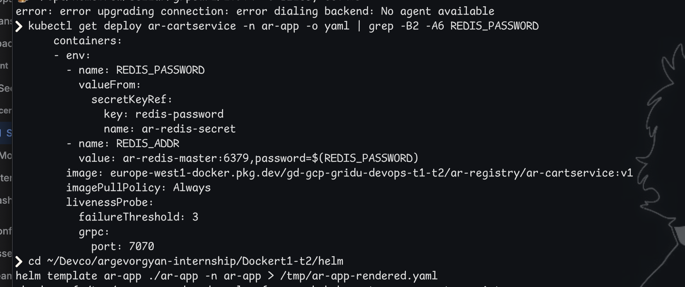

The rendered chart passes Checkov and Trivy with 0 failures. Documented skips: image digest, and "secrets as files" for cartservice only, because it can only read its Redis connection string from an env var (which comes from the Secret).

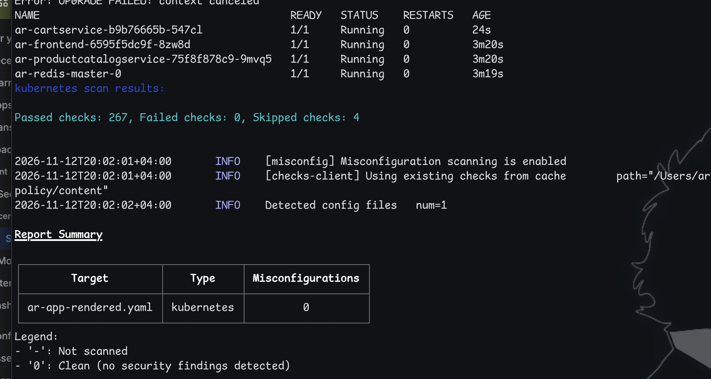

**Does it really use Redis?** The "in memory store" line is gone from the cartservice log, and a cart item added in the browser shows up as a key in Redis:

```bash
kubectl port-forward -n ar-app svc/ar-frontend 8080:80      # open http://localhost:8080, add an item
kubectl exec -n ar-app ar-redis-master-0 -- sh -c 'redis-cli -a "$(cat /opt/bitnami/redis/secrets/redis-password)" --no-auth-warning keys "*"'
```

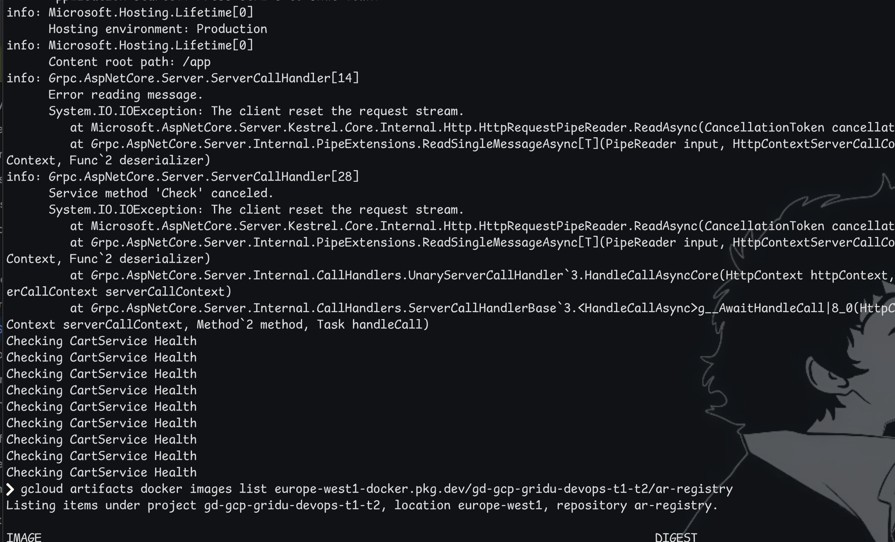
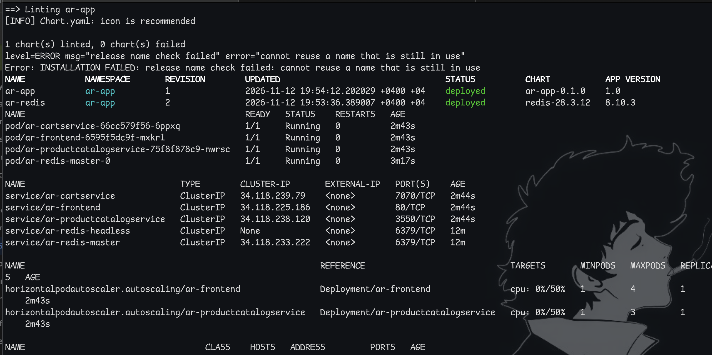
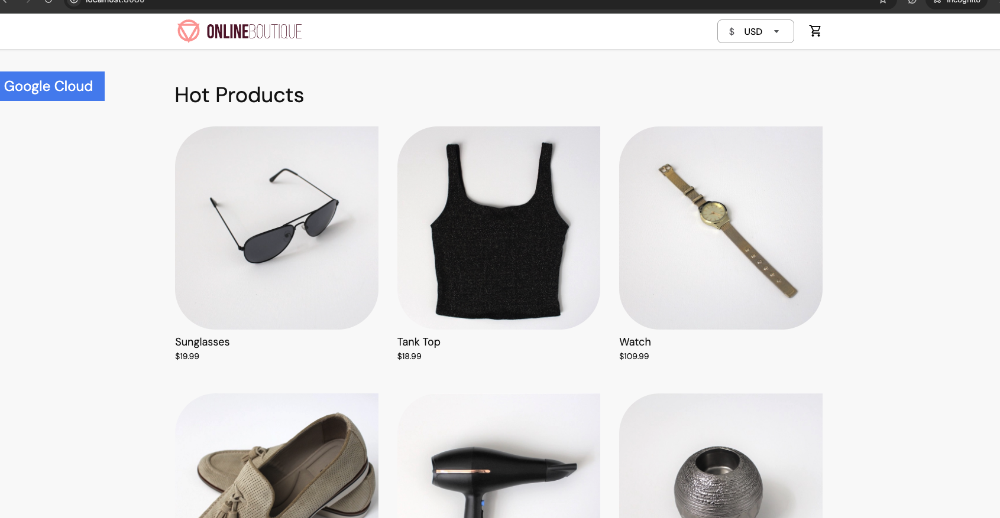
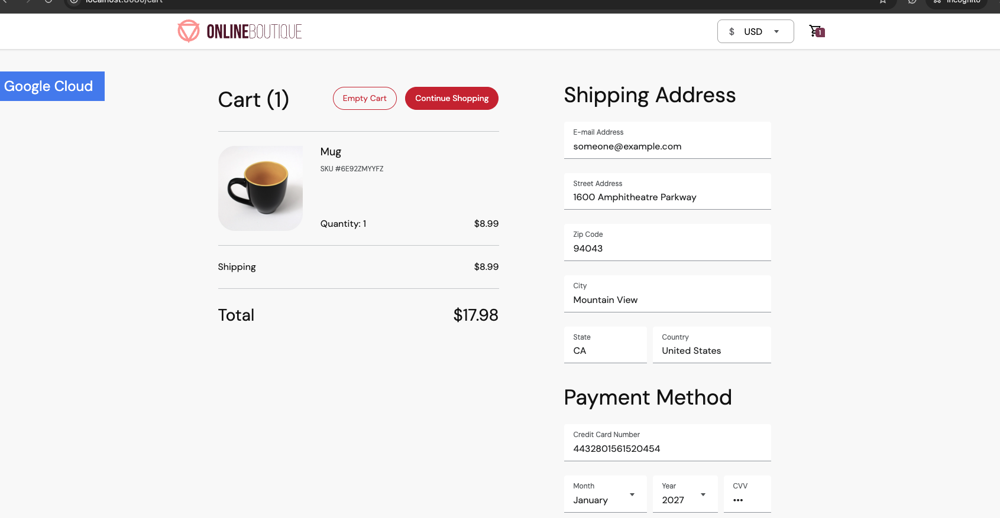

## What doesn't work

- **The Ingress returns 502.** The load balancer and its IP were created, but the backend health stays `Unknown`. Probably a health-check firewall issue in this shared project where I have limited permissions. Everything else, including the app through `kubectl port-forward`, works.
- **Only 5 of 11 services** are deployed, so placing an order and the ads/recommendations don't work. Catalog, currency, cart (in Redis) and the shipping quote do.
- `kubectl logs/exec/port-forward` failed for a while with `No agent available` (GKE konnectivity agent) and then recovered.

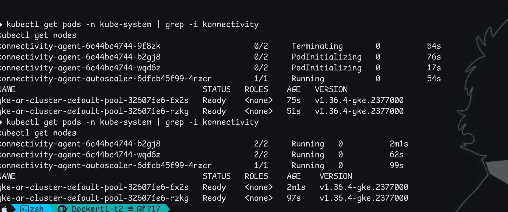

## Cleanup

```bash
helm uninstall ar-app ar-redis -n ar-app
kubectl delete namespace ar-app
gcloud container clusters delete ar-cluster --zone=europe-west1-b
gcloud artifacts repositories delete ar-registry --location=europe-west1
```
