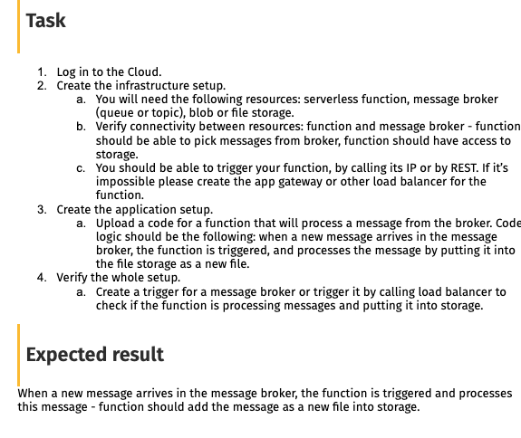
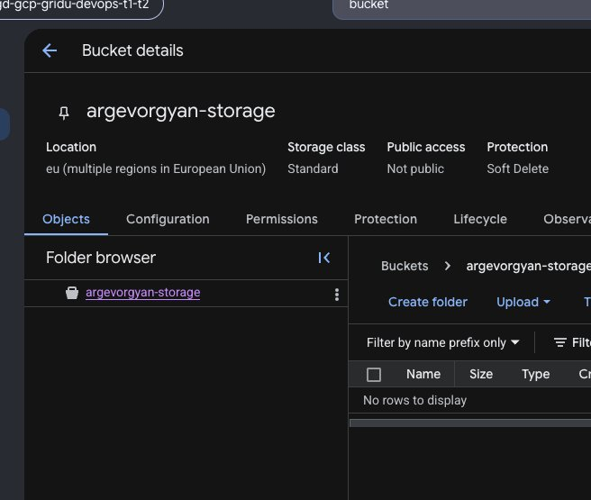
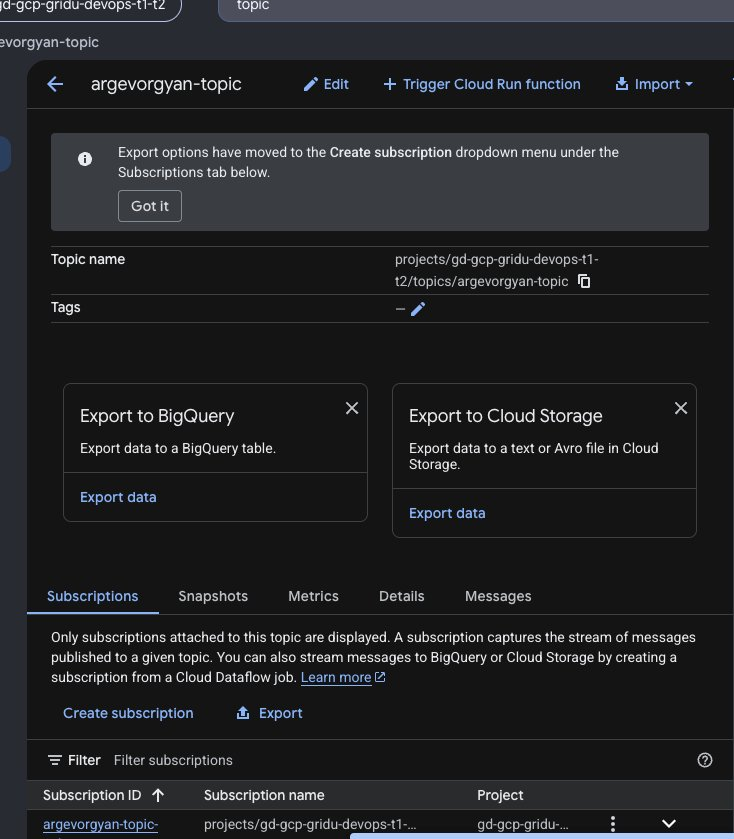
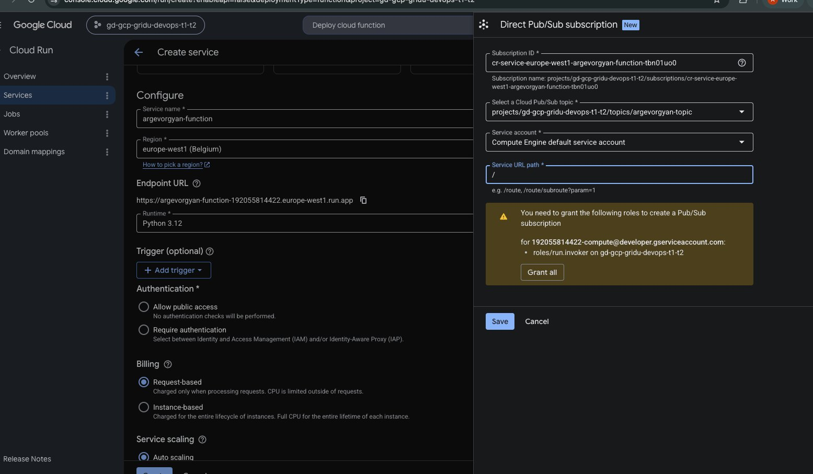
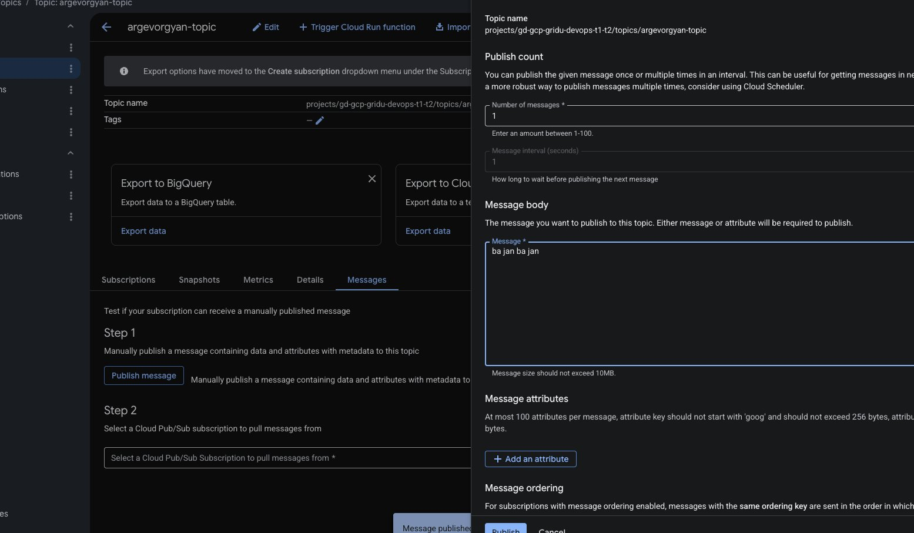
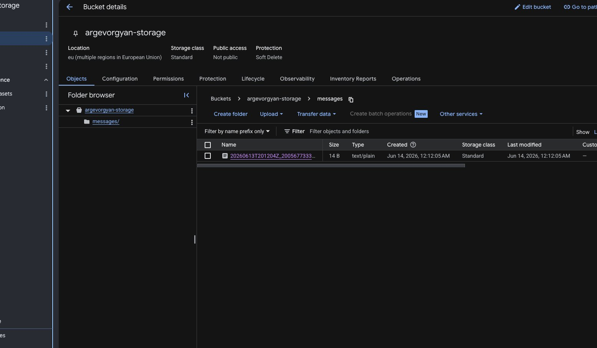
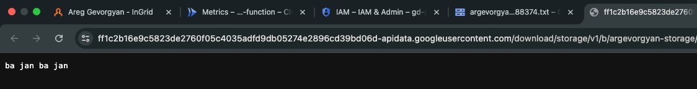

# Module 1 – Cloud Technologies Basic Task (GCP)



**Pub/Sub topic → Cloud Run function → Cloud Storage bucket**

When a message is published to the topic, the Cloud Run function is triggered and saves the message as a `.txt` file in the storage bucket.

---

## Resources Created

| Resource | Name | Type |
|---|---|---|
| Cloud Storage bucket | `argevorgyan-storage` | Multi-region (EU), Standard |
| Pub/Sub topic | `argevorgyan-topic` | With direct push subscription |
| Cloud Run function | `argevorgyan-function` | Python 3.12, europe-west1 |

All resources use the `argevorgyan` prefix for easy identification and cleanup.

---

## Step 1 – Create Cloud Storage Bucket

Created a Cloud Storage bucket with multi-region (EU) location and Standard storage class. Public access is disabled.



---

## Step 2 – Create Pub/Sub Topic

Created a Pub/Sub topic `argevorgyan-topic` with a default direct push subscription that delivers messages to the Cloud Run function URL.



---

## Step 3 – Deploy Cloud Run Function

Used the GCP Console inline editor (Cloud Run → "Use an inline editor to create a function") to deploy a Python 3.12 function.

The Pub/Sub **Direct** trigger was added during service creation, pointing to `argevorgyan-topic`. The `BUCKET_NAME` environment variable was set to `argevorgyan-storage`.



### Function code (`main.py`)

```python
import base64
import datetime
import json
import os

from google.cloud import storage


def process_message(request):
    bucket_name = os.environ["BUCKET_NAME"]

    request_json = request.get_json(silent=True)
    if not request_json or "message" not in request_json:
        return ("Bad Request", 400)

    message_json = request_json["message"]
    if "data" not in message_json:
        return ("Bad Request", 400)

    encoded_data = message_json["data"]
    try:
        message_data = base64.b64decode(encoded_data).decode("utf-8")
    except Exception:
        message_data = str(encoded_data)

    timestamp = datetime.datetime.utcnow().strftime("%Y%m%dT%H%M%SZ")
    message_id = message_json.get("messageId", "unknown")
    filename = "messages/" + timestamp + "_" + message_id + ".txt"

    client = storage.Client()
    bucket = client.bucket(bucket_name)
    blob = bucket.blob(filename)
    blob.upload_from_string(message_data, content_type="text/plain")

    print("Written to gs://" + bucket_name + "/" + filename)
    return ("OK", 200)
```

### Dependencies (`requirements.txt`)

```
functions-framework==3.8.1
google-cloud-storage==2.16.0
```

---

## Step 4 – Verify End-to-End

Published a test message via Pub/Sub → Messages → Publish message:



The function was triggered automatically via the push subscription. The message was written as a new file under `messages/` in the bucket:



Opening the file confirms the message content was stored correctly:




All resources were deleted after the task completion.
