# Module 2 — Cloud Advanced: Kubernetes Infrastructure on GCP

## Architecture Overview

A full Kubernetes-based cloud infrastructure on GCP including: VPC with private/public subnets, Artifact Registry, GCS bucket, Pub/Sub, Cloud SQL (PostgreSQL), Secret Manager, bastion host, GKE cluster, monitoring dashboard, External Secrets Operator, KEDA, Metrics Server, and three deployed applications routed via nginx Ingress.

All resources use the `argevorgyan-` prefix. Project: `gd-gcp-gridu-devops-t1-t2`.

---

## Networking

### VPC & Subnets

Created a custom VPC (`argevorgyann-vpc`) with two subnets in `europe-west1`:
- `argevorgyan-subnet-public` — for the bastion host and GKE nodes
- `argevorgyan-subnet-private` — secondary subnet

Private Google Access enabled on both subnets so VMs and pods can reach Google APIs (GCS, Artifact Registry, Pub/Sub) without going through the public internet.

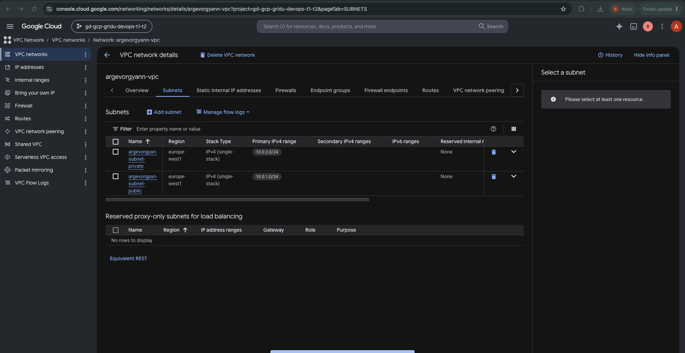

### Cloud NAT

Created `argevorgyan-nat` (via `argevorgyan-router`) in `europe-west1` to give nodes outbound internet access for pulling images etc.

- Source: VM instances, GKE nodes, Serverless
- All subnets' primary and secondary IP ranges covered
- Allocation type: Automatic

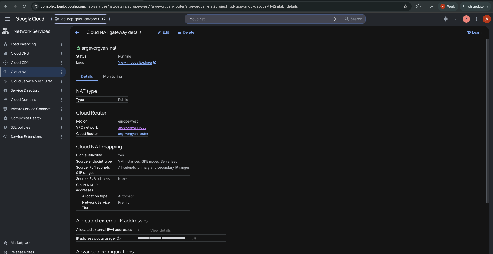

---

## Storage & Registry

### Artifact Registry

Created Docker registry `argevorgyan-registry` in `europe-west1` (Standard type) to store container images for GKE workloads.

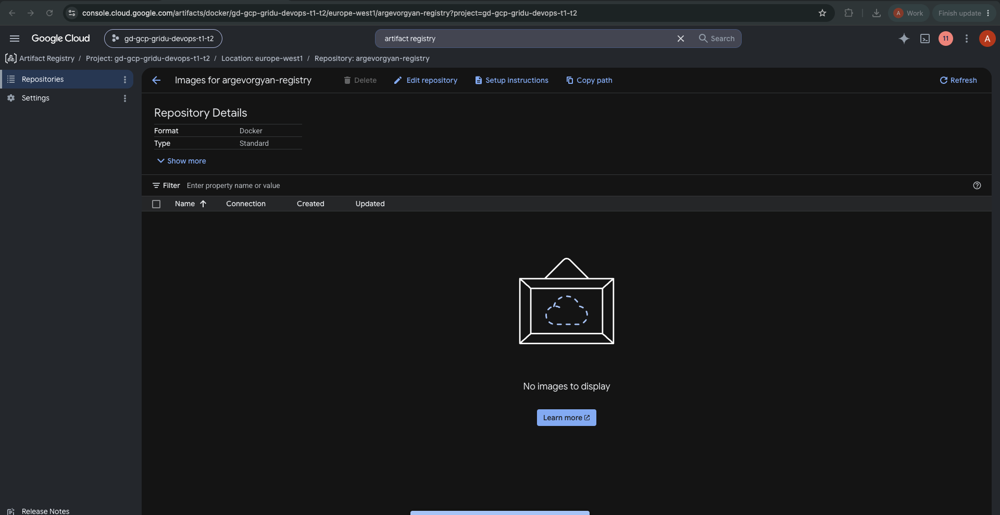

Added a cleanup lifecycle policy (`argevorgyan-delete-old`): automatically deletes tagged images older than 30 days.

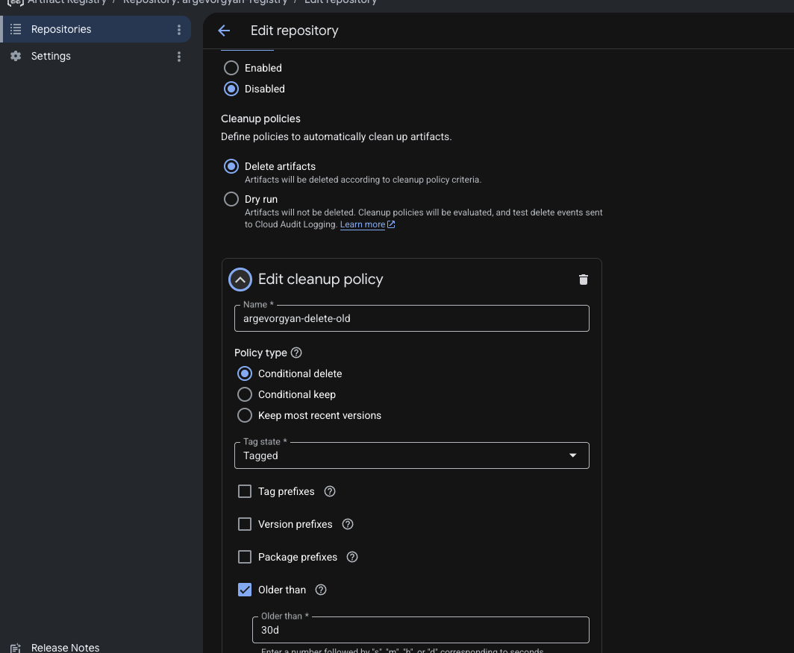

### GCS Bucket

Created `argevorgyan-bucket` in `europe-west1` (Standard storage class, not public) for application file storage.

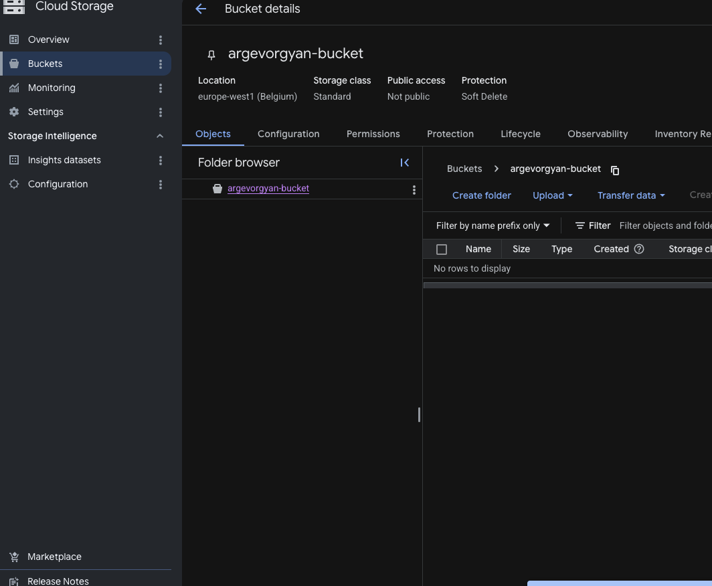

Added two lifecycle rules for cost-optimised tiering:
- **Set to Nearline** after 30 days
- **Set to Coldline** after 90 days

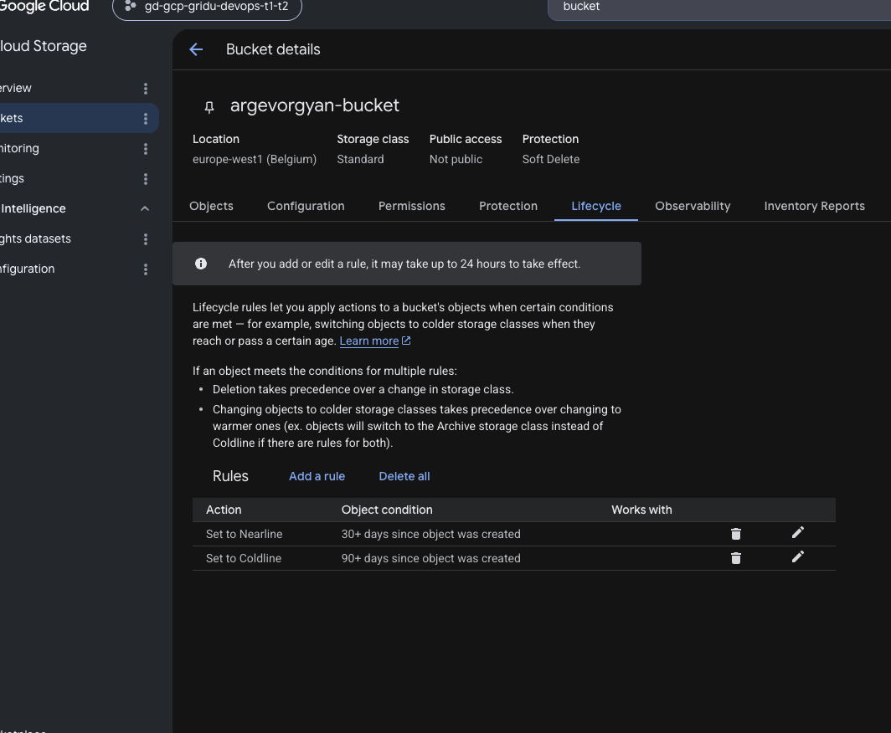

---

## Data & Secrets

### Cloud SQL (PostgreSQL)

Created `argevorgyan-db` — PostgreSQL 18, `db-f1-micro`, `europe-west1`, Enterprise edition.

Public IP used with authorized networks (workaround for `servicenetworking.services.addPeering` permission restriction in the shared project).

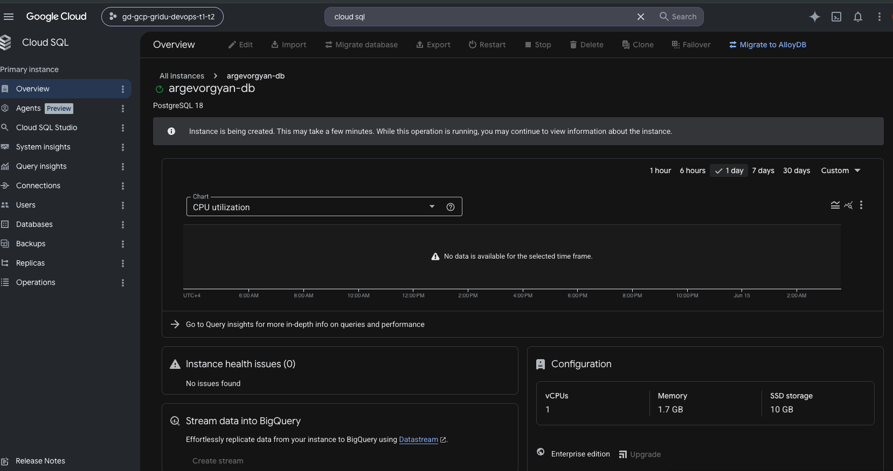

Created database user `argevorgyan-db-user`:

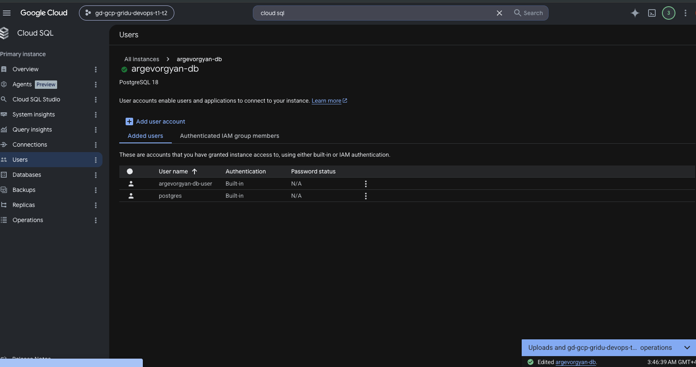

### Secret Manager

Stored the database password as secret `argevorgyan-db-password` in Secret Manager. Synced into Kubernetes via External Secrets Operator — credentials never hardcoded in manifests.

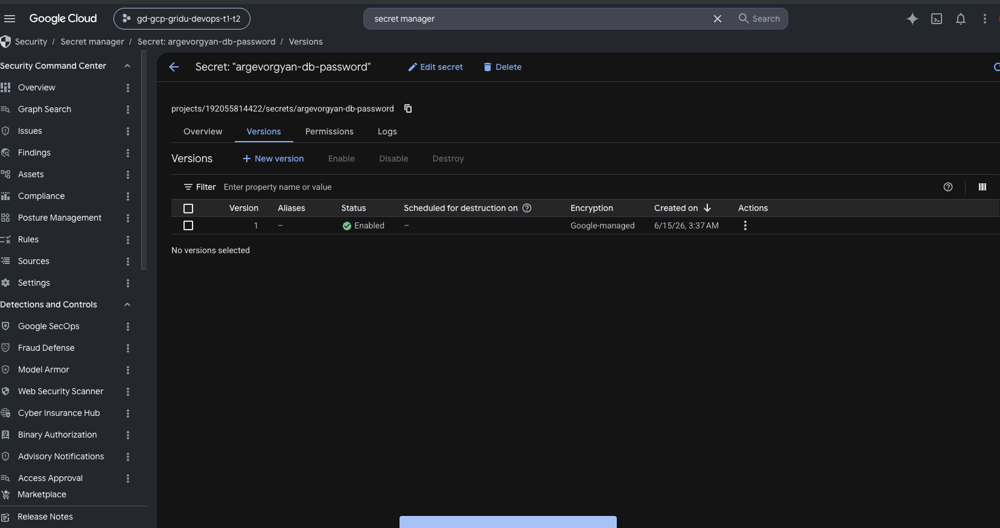

### Bastion Host

Created `argevorgyan-bastion` VM (`e2-micro`, Debian 12) in `argevorgyan-subnet-public`. Used as a jump host for initial Cloud SQL setup via Cloud SQL Proxy:

```sql
CREATE DATABASE argevorgyan_appdb;
\c argevorgyan_appdb
CREATE TABLE uploads (
    id SERIAL PRIMARY KEY,
    filename VARCHAR(255) NOT NULL,
    gcs_path VARCHAR(500) NOT NULL,
    created_at TIMESTAMP DEFAULT NOW()
);
```

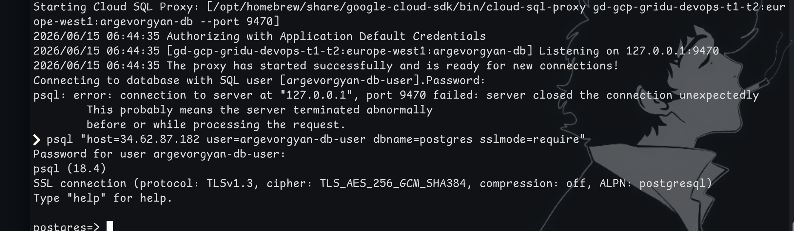


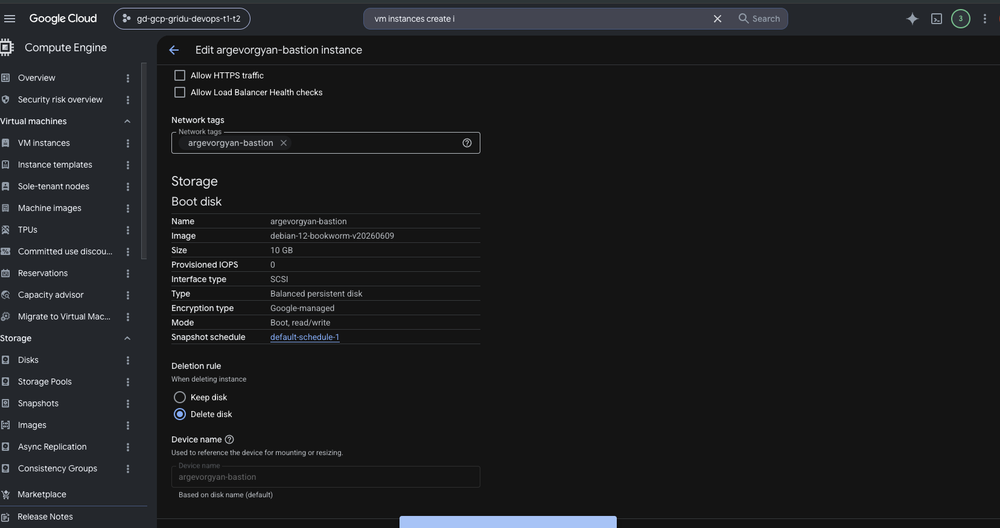

---

## GKE Cluster

Created `argevorgyan-cluster` — Standard mode, regional, `europe-west1`, 3 nodes (`e2-small`), subnet `argevorgyan-subnet-public`.

Key settings:
- Network: `argevorgyann-vpc`
- Workload Identity enabled
- GCP SA key mounted as Kubernetes secret volume (fallback for Workload Identity — project-level IAM binding restricted)

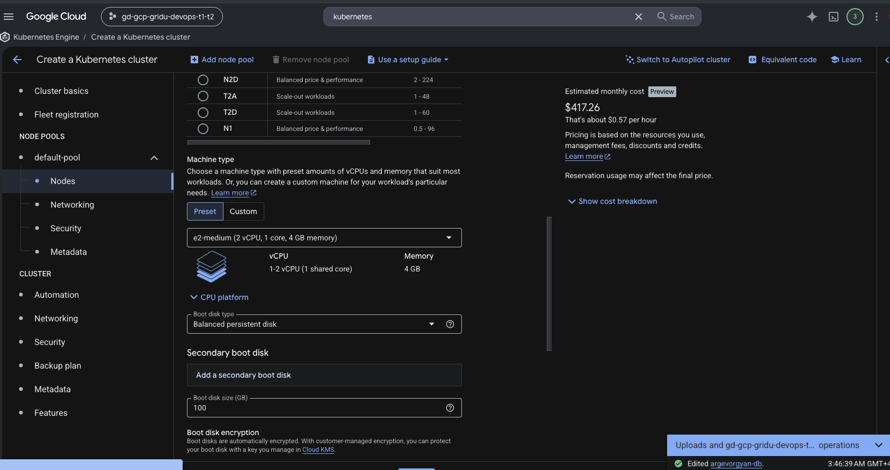

---

## Monitoring Dashboard

Created `argevorgyan-dashboard` in Cloud Monitoring with 4 widgets:

| Widget | Metric |
|--------|--------|
| CPU Usage | `kubernetes.io/container/cpu/core_usage_time` |
| Memory Usage | `kubernetes.io/container/memory/used_bytes` |
| Cloud SQL CPU | `cloudsql.googleapis.com/database/cpu/utilization` |
| GCS Bucket Size | `storage.googleapis.com/storage/total_bytes` |

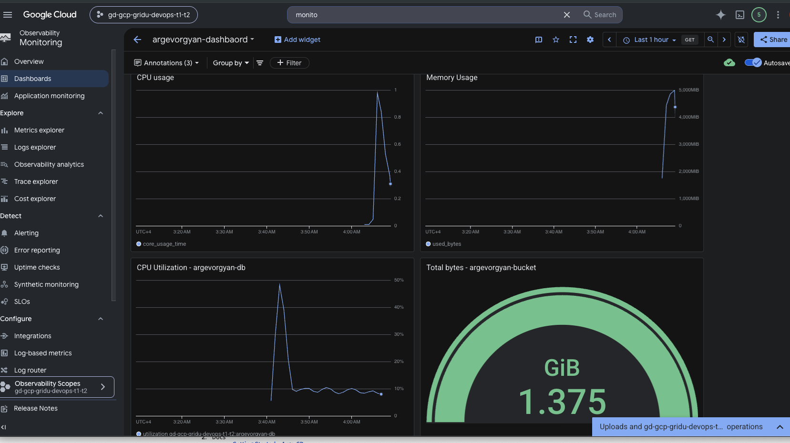

---

## Kubernetes Addons

Connected to the cluster and installed three addons via Helm:

```bash
# External Secrets Operator
helm install external-secrets external-secrets/external-secrets -n external-secrets --create-namespace

# KEDA
helm install keda kedacore/keda -n keda --create-namespace

# Metrics Server
kubectl apply -f https://github.com/kubernetes-sigs/metrics-server/releases/latest/download/components.yaml

# nginx Ingress Controller
helm install ingress-nginx ingress-nginx/ingress-nginx -n ingress-nginx --create-namespace
```


### External Secrets Operator → Secret Manager

Created a `ClusterSecretStore` pointing to GCP Secret Manager using a service account key, then an `ExternalSecret` to sync `argevorgyan-db-password` into Kubernetes secret `db-credentials`.

IAM binding granted at the secret resource level (project-level IAM was restricted):

```bash
gcloud secrets add-iam-policy-binding argevorgyan-db-password \
  --member="serviceAccount:argevorgyan-app-sa@gd-gcp-gridu-devops-t1-t2.iam.gserviceaccount.com" \
  --role="roles/secretmanager.secretAccessor"
```

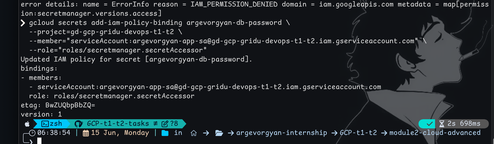


ExternalSecret synced successfully — `db-credentials` Kubernetes secret created from Secret Manager:


---

## Applications

### Structure

```
apps/
├── backend/        # FastAPI — upload → GCS + PostgreSQL + Pub/Sub
│   ├── main.py
│   ├── requirements.txt
│   └── Dockerfile
└── frontend/       # nginx serving HTML upload UI
    ├── index.html
    ├── nginx.conf
    └── Dockerfile
```

Image-processor uses the public `stefanprodan/podinfo` image.

### Backend

FastAPI app with two endpoints:
- `POST /upload` — saves file to GCS (`argevorgyan-bucket`), inserts a row into `uploads` table in Cloud SQL, publishes a message to `argevorgyan-topic`
- `GET /uploads` — returns last 20 uploads from the database

DB credentials injected via ESO-synced Kubernetes secret. GCP credentials mounted from `gcp-sa-key` secret volume.

### Frontend

Single-page nginx app with a drag-and-drop file upload form. Displays recent uploads on load.

### Build & Push

Images built for `linux/amd64` (required for GKE x86 nodes when building on Apple Silicon):

```bash
docker build --platform linux/amd64 -t europe-west1-docker.pkg.dev/gd-gcp-gridu-devops-t1-t2/argevorgyan-registry/backend:v1 apps/backend/
docker push europe-west1-docker.pkg.dev/gd-gcp-gridu-devops-t1-t2/argevorgyan-registry/backend:v1

docker build --platform linux/amd64 -t europe-west1-docker.pkg.dev/gd-gcp-gridu-devops-t1-t2/argevorgyan-registry/frontend:v1 apps/frontend/
docker push europe-west1-docker.pkg.dev/gd-gcp-gridu-devops-t1-t2/argevorgyan-registry/frontend:v1
```

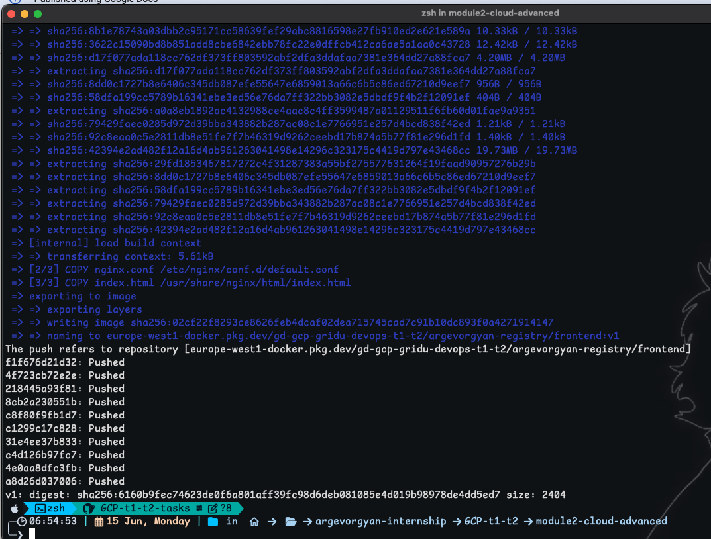

### Kubernetes Manifests

Deployed to namespace `argevorgyan-app`:

```bash
kubectl apply -f cluster-secret-store.yaml
kubectl apply -f external-secret.yaml
kubectl apply -f k8s/backend.yaml
kubectl apply -f k8s/frontend.yaml
kubectl apply -f k8s/image-processor.yaml
kubectl apply -f k8s/ingress.yaml
```

All 3 pods Running:

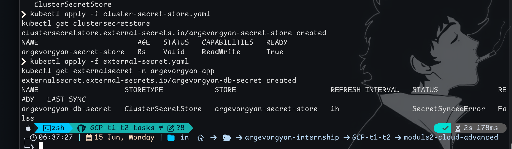

### Ingress — Path-Based Routing

Used nginx Ingress Controller (GCE Ingress health checks require firewall permissions unavailable in the shared project). The nginx controller creates a single LoadBalancer and routes internally:

| Path | Backend |
|------|---------|
| `/` | frontend (nginx) |
| `/upload`, `/uploads`, `/health` | backend (FastAPI) |
| `/processor` | image-processor (podinfo) |

External IP: `34.62.99.102`

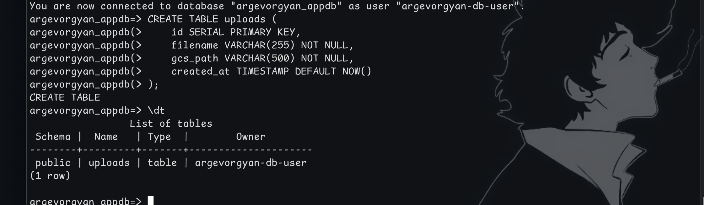

### Running Applications

**Frontend — Image Uploader** (`http://34.62.99.102`):

Upload an image → saved to GCS, logged in PostgreSQL, published to Pub/Sub. Recent uploads shown on page load.

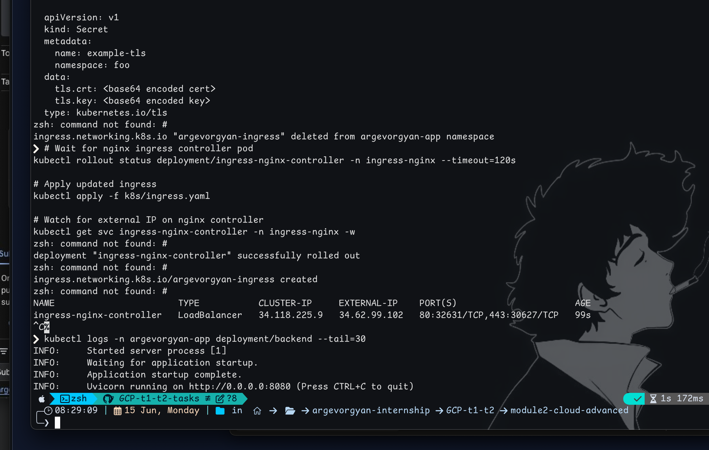

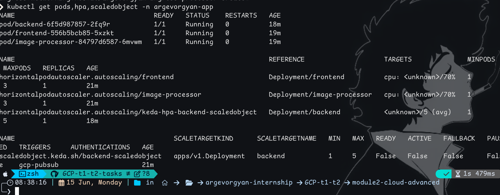

**GCS — Uploaded Files**:

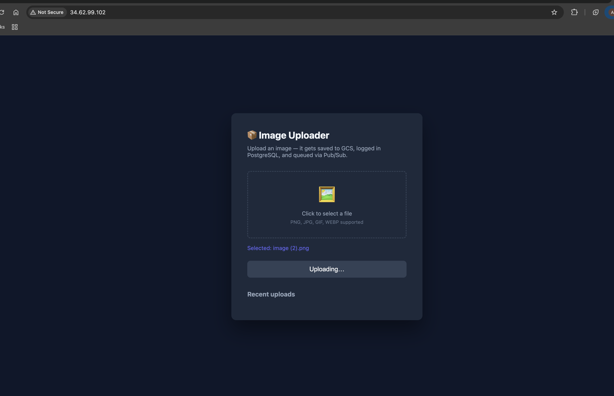

**Image Processor — podinfo** (`http://34.62.99.102/processor`):

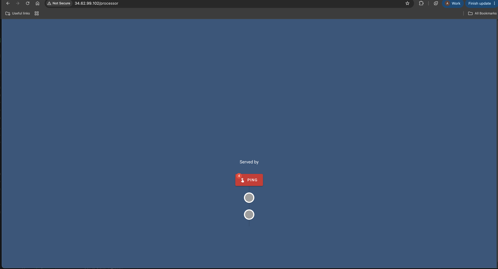

### Autoscaling

#### KEDA — Event-Driven Scaling (backend)

`ScaledObject` scales the backend deployment based on `argevorgyan-subscription` Pub/Sub queue depth (1 replica per 5 unprocessed messages, max 5):

```yaml
apiVersion: keda.sh/v1alpha1
kind: ScaledObject
metadata:
  name: backend-scaledobject
  namespace: argevorgyan-app
spec:
  scaleTargetRef:
    name: backend
  minReplicaCount: 1
  maxReplicaCount: 5
  triggers:
    - type: gcp-pubsub
      metadata:
        subscriptionName: argevorgyan-subscription
        value: "5"
```

#### HPA — CPU-Based Scaling (frontend & image-processor)

```bash
kubectl autoscale deployment frontend -n argevorgyan-app --cpu-percent=70 --min=1 --max=3
kubectl autoscale deployment image-processor -n argevorgyan-app --cpu-percent=70 --min=1 --max=3
```

---

## Security Notes

- Credentials stored in Secret Manager and synced to Kubernetes via ESO — never hardcoded in manifests
- GCP service account key mounted as a Kubernetes secret volume (Workload Identity binding blocked by project IAM restrictions)
- Cloud SQL uses Public IP restricted to authorised networks (Private Service Connect unavailable due to `servicenetworking.services.addPeering` restriction)
- Private Google Access on subnets: pods reach GCS/Artifact Registry/Pub/Sub via Google's internal backbone without public internet
