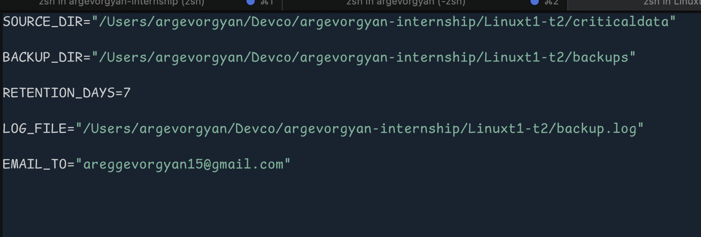
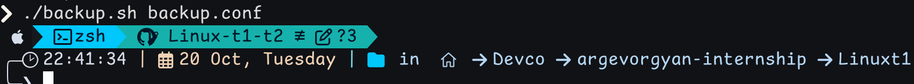
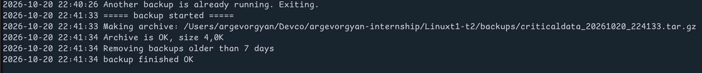
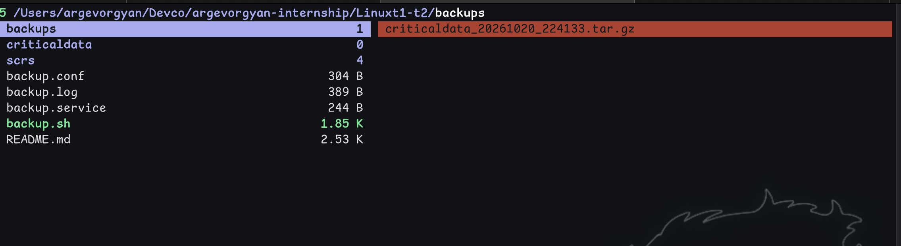
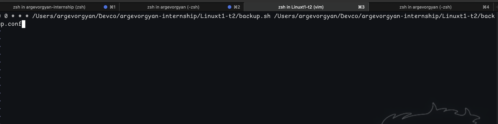
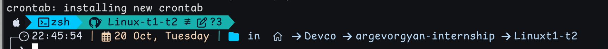

# linuxt1-t2: Folder Backup

A simple backup script for Linux. It makes a compressed copy of a folder,
keeps it for a set number of days, and emails you the result.

## Files

| File | What it is |
|------|------------|
| `backup.sh` | The backup script |
| `backup.conf` | Settings: folder to back up, backup folder, days to keep, log file, email |
| `backup.service` | Systemd service to run the backup on boot or by hand |

## What the script does

- Makes a `.tar.gz` file with the date and time in the name, for example `data_20261020_000001.tar.gz`.
- Checks the archive is not broken before keeping it.
- Deletes backups older than `RETENTION_DAYS`.
- Writes every step to the log file.
- Sends an email on success or failure.
- Uses a lock file, so two copies of the script never run at the same time.

## Requirements

- Linux with systemd (Ubuntu, Debian, etc.)
- `tar`, `find`, `flock` (already on most systems)
- A mail program for email alerts, for example `sudo apt install mailutils`.
  Without it the backup still runs, but no email is sent.

## Setup

Copy the files to your project directory:

```
cp backup.sh backup.conf backup.service /path/to/your/backup/dir/
chmod +x backup.sh
```

Then edit `backup.conf` and set your own folders and email.

## Config settings

Example `backup.conf`:

```
SOURCE_DIR="/Users/argevorgyan/Devco/argevorgyan-internship/Linuxt1-t2/criticaldata"     # folder to back up
BACKUP_DIR="/Users/argevorgyan/Devco/argevorgyan-internship/Linuxt1-t2/backups"          # where backups are saved
RETENTION_DAYS=7                                                                          # delete backups older than this
LOG_FILE="/Users/argevorgyan/Devco/argevorgyan-internship/Linuxt1-t2/backup.log"         # log file
EMAIL_TO="areggevorgyan15@gmail.com"                                                      # empty = no email
```

Replace paths with your own directories.

## Test it

```
./backup.sh backup.conf
tail backup.log
```

## Schedule with cron (daily at midnight)

Run `crontab -e` and add this line:

```
0 0 * * * /path/to/backup.sh /path/to/backup.conf
```

Example (from this repo):
```
0 0 * * * /Users/argevorgyan/Devco/argevorgyan-internship/Linuxt1-t2/backup.sh /Users/argevorgyan/Devco/argevorgyan-internship/Linuxt1-t2/backup.conf
```

## Run with systemd (Linux)

If using systemd, edit `backup.service` to point to your script path:

```
[Service]
ExecStart=/path/to/backup.sh /path/to/backup.conf
```

Then:

```
sudo cp backup.service /etc/systemd/system/
sudo systemctl daemon-reload
sudo systemctl enable backup.service   # run at every boot
sudo systemctl start backup.service    # run a backup now
sudo systemctl stop backup.service
sudo systemctl status backup.service
```

Notes:
- Each start of the service runs one backup, including at boot.
- Stopping the service does not cancel a backup that is already running.
- If you only want the midnight cron job, skip the `enable` step.

## Mac Setup (launchd)

On macOS, use `launchd` instead of systemd. Create a plist file with your paths:

```bash
cat > ~/Library/LaunchAgents/com.backup.plist << 'EOF'
<?xml version="1.0" encoding="UTF-8"?>
<!DOCTYPE plist PUBLIC "-//Apple//DTD PLIST 1.0//EN" "http://www.apple.com/DTDs/PropertyList-1.0.dtd">
<plist version="1.0">
<dict>
    <key>Label</key>
    <string>com.backup</string>
    <key>ProgramArguments</key>
    <array>
        <string>/Users/argevorgyan/Devco/argevorgyan-internship/Linuxt1-t2/backup.sh</string>
        <string>/Users/argevorgyan/Devco/argevorgyan-internship/Linuxt1-t2/backup.conf</string>
    </array>
    <key>StartCalendarInterval</key>
    <dict>
        <key>Hour</key>
        <integer>0</integer>
        <key>Minute</key>
        <integer>0</integer>
    </dict>
    <key>StandardErrorPath</key>
    <string>/Users/argevorgyan/Devco/argevorgyan-internship/Linuxt1-t2/backup.log</string>
    <key>StandardOutPath</key>
    <string>/Users/argevorgyan/Devco/argevorgyan-internship/Linuxt1-t2/backup.log</string>
</dict>
</plist>
EOF
```

Then load and manage it:

```bash
launchctl load ~/Library/LaunchAgents/com.backup.plist
launchctl start com.backup
launchctl stop com.backup
launchctl unload ~/Library/LaunchAgents/com.backup.plist
```

Replace paths with your actual backup.sh and backup.conf locations.

## Screenshots

### Config Setup


### Enable Service (Linux)


### Test Run


### Service Status


### View Logs


### Backup Created


### Cron Job


## Notes

- Run everything as root. If cron and the service use different users,
  the lock file in `/tmp` may cause permission errors.
- Check the log file first when something goes wrong.
- The script works on both Linux and Mac; only the scheduling method differs
  (systemd for Linux, launchd for Mac).
