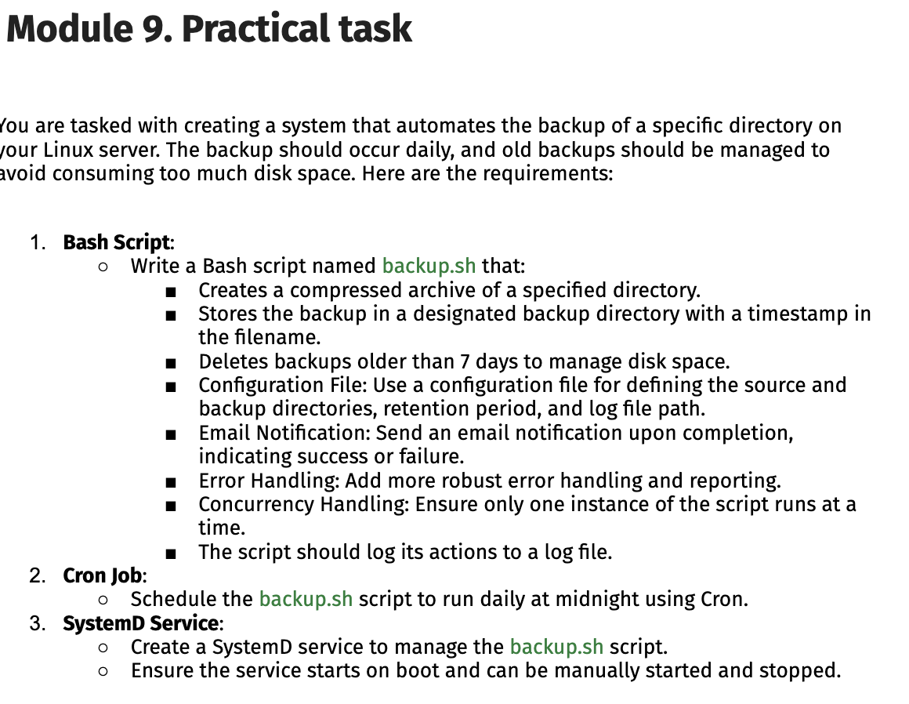

# linuxt1-t2: Folder Backup



Automated backup system that compresses, retains, and restores data.


## What it does

**Backup**: Compress folder to `.tar.gz` with timestamp  
**Delete**: Remove backups older than 7 days  
**Verify**: Check archive integrity before keeping  
**Log**: Record every action to log file  
**Schedule**: Run daily via cron or systemd  
**Email**: Notify on success/failure (Linux)  
**Prevent**: Lock file stops concurrent runs  
**Extract**: Restore from backup to `extract/` folder

## Files

| File | Purpose |
|------|---------|
| `backup.sh` | Main script (backup, delete, extract) |
| `backup.conf` | Config: source dir, backup dir, retention days, log, email |
| `backup.service` | Systemd unit for Linux |

## Setup

```bash
cp backup.sh backup.conf backup.service .
chmod +x backup.sh
```

Edit `backup.conf`:

```bash
SOURCE_DIR="/Users/argevorgyan/Devco/argevorgyan-internship/Linuxt1-t2/criticaldata"
BACKUP_DIR="/Users/argevorgyan/Devco/argevorgyan-internship/Linuxt1-t2/backups"
RETENTION_DAYS=7
LOG_FILE="/Users/argevorgyan/Devco/argevorgyan-internship/Linuxt1-t2/backup.log"
EMAIL_TO="areggevorgyan15@gmail.com"
```

## Commands

**Backup now:**
```bash
./backup.sh backup.conf
```

**View log:**
```bash
tail -f backup.log
```

**Extract from backup:**
```bash
./backup.sh backup.conf extract backups/criticaldata_20261020_230252.tar.gz
```

## Schedule

**Cron (Linux/Mac):**
```bash
crontab -e
0 0 * * * /full/path/to/backup.sh /full/path/to/backup.conf
```

**Systemd (Linux only):**
```bash
sudo cp backup.service /etc/systemd/system/
sudo systemctl enable backup.service
sudo systemctl start backup.service
```

## Testing Results

 Config file  
 Test run  
 Log output  
 Backup created  
 Cron scheduled  
 
