# python-t1-t2: Serverless data pipeline on GCP

A Python Cloud Function that fetches a GitHub organisation's public repos, validates and transforms them, and stores them in Firestore. All the infrastructure is created from Python scripts using the Google Cloud SDKs (no console clicking, no `gcloud` for provisioning).

```
GitHub API ──> Cloud Function (Python 3.12) ──> Firestore (ar-serverless-db)
 (retries,       fetch -> validate -> transform -> store     |-- ar_github_repos (data)
  rate limits)         |                                     '-- ar_runs (audit log)
                       '--> JSON logs --> log-based metric --> alert policy --> email
                       '--> Monitoring: dashboard + 5xx / latency alerts
```

Everything is named `ar-...`. Project `gd-gcp-gridu-devops-t1-t2`, region `europe-west1`.

## Layout

| Path | What it is |
|------|------------|
| `function/pipeline.py` | Fetch (retry, backoff, rate limits), validate, transform |
| `function/store.py` | Idempotent Firestore writes, health check, run audit record |
| `function/main.py` | HTTP entry point, JSON logging, `GET /health` |
| `infra/deploy.py` | Creates everything with the SDKs |
| `infra/healthcheck.py` | Checks the database and the function |
| `infra/invoke.py` | Calls the function, shows what landed in Firestore |
| `infra/destroy.py` | Deletes everything |
| `tests/` | 27 unit tests |

## What `deploy.py` creates

| Step | SDK | Details |
|------|-----|---------|
| Enable APIs | `google-cloud-service-usage` | Firestore, Functions, Build, Run, Logging, Monitoring |
| Database | `google-cloud-firestore` (admin) | `ar-serverless-db`, native mode. Schemaless, the document shape lives in `pipeline.transform()`. Composite index `language ASC, stars DESC` |
| Service account + access | `google-cloud-iam`, `google-cloud-resource-manager` | `ar-fn-runtime` with `roles/datastore.user`, restricted by an IAM condition to this one database |
| Function | `google-cloud-functions`, `google-cloud-storage` | Gen2, private (needs an identity token), source uploaded to a bucket, config via env vars |
| Logging | `google-cloud-logging` | JSON logs, log-based metric `ar_fn_pipeline_errors` counting ERROR entries |
| Monitoring | `google-cloud-monitoring` | Email channel, 3 alert policies (5xx, p95 latency > 30s, errors in logs), dashboard |

## Error handling

- **Fetch:** pagination; network errors, timeouts and 5xx are retried with exponential backoff and jitter (3 retries). On a rate limit (`429`, or `403` with `X-RateLimit-Remaining: 0`) it waits for `Retry-After` / the reset time, capped at 30s, otherwise fails clearly. 404 and other 4xx are not retried.
- **Validate:** shape and type checks per record, duplicates dropped, bad records rejected, logged and counted. If everything is bad the run fails.
- **Transform:** lowercase language (`unknown` if missing), parsed timestamps, `popularity` bucket, fetch time, content hash.
- **Store:** doc id = repo id, batched `merge` writes, unchanged hashes skipped. Re-running is safe.
- **Audit:** each run writes a record to `ar_runs`.
- **Status codes:** `200` ok, `400` bad input, `502` external API failed, `500` anything else.

## Run it

Setup:

```bash
cd ~/Devco/argevorgyan-internship/python-t1-t2
python3 -m venv .venv && source .venv/bin/activate
pip install -r infra/requirements.txt -r function/requirements.txt
gcloud auth login
gcloud auth application-default login
gcloud config set project gd-gcp-gridu-devops-t1-t2
```

### 1. Tests

```bash
python -m unittest discover -s tests
```

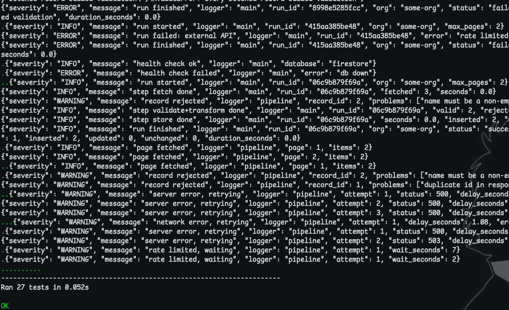

### 2. Deploy

```bash
cd infra
python deploy.py --alert-email YOUR_EMAIL
```

Takes 5 to 10 minutes and is safe to re-run. My account can't set project IAM policies, so the service-account step was skipped and the function runs as the default compute service account instead (`--runtime-sa`). With full rights, leave that flag out and it uses `ar-fn-runtime`.

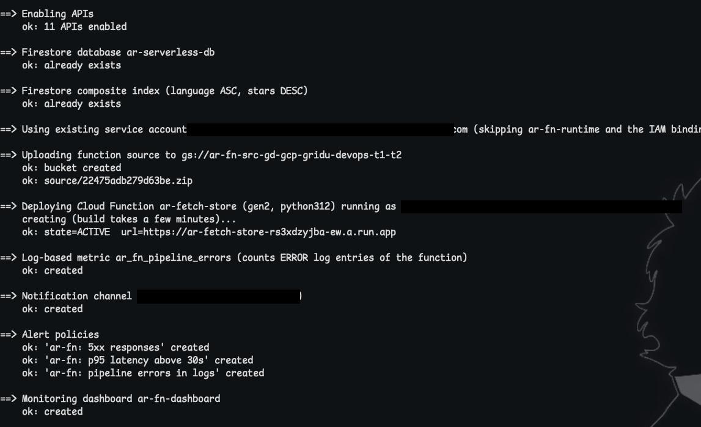

The function's configuration in the console:

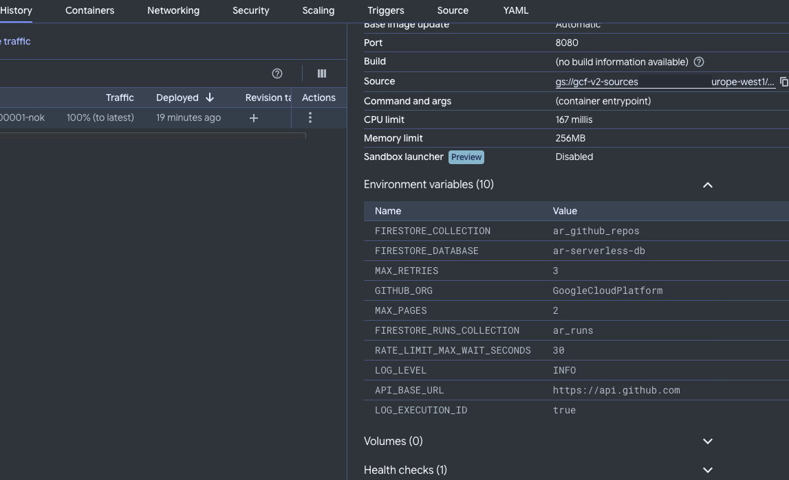

### 3. Health checks and first run

```bash
python healthcheck.py
python invoke.py
```

Four checks (database exists, read/write, function ACTIVE, `/health` endpoint), then a run that inserts 50 repos.

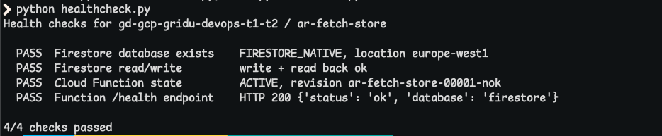
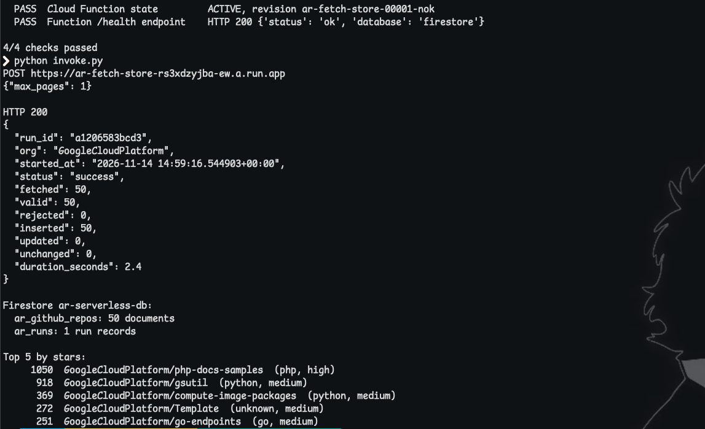

Running `invoke.py` again returns `inserted: 0, unchanged: 50`.

### 4. Logs and metrics

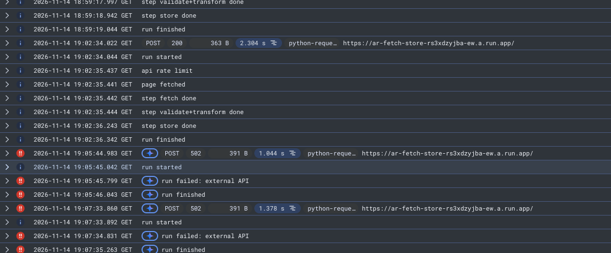
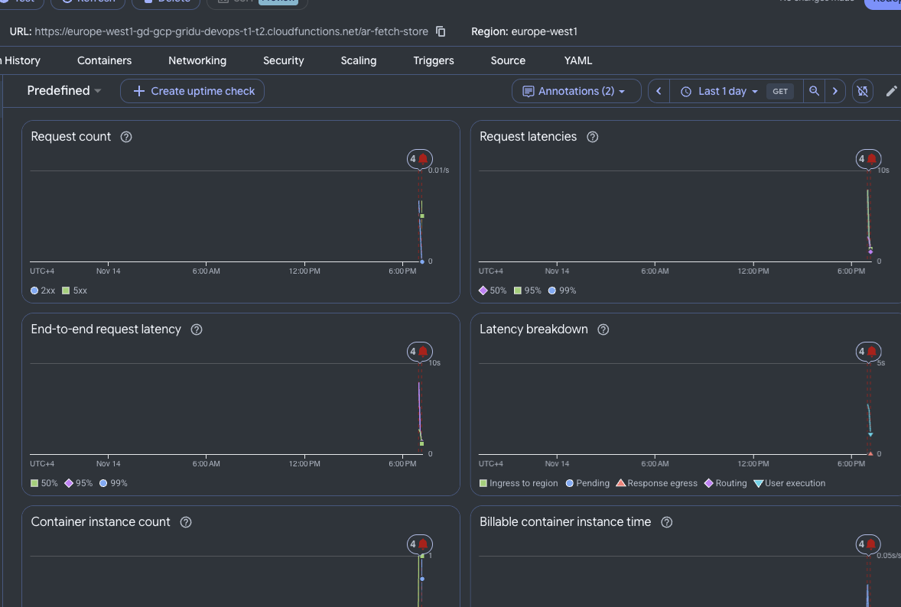

### 5. Error path and alerts

```bash
python invoke.py --org this-org-does-not-exist-xyz
```

Returns HTTP 502 (the 404 is not retried) and logs an ERROR. After a few runs both alerts fired and emailed:

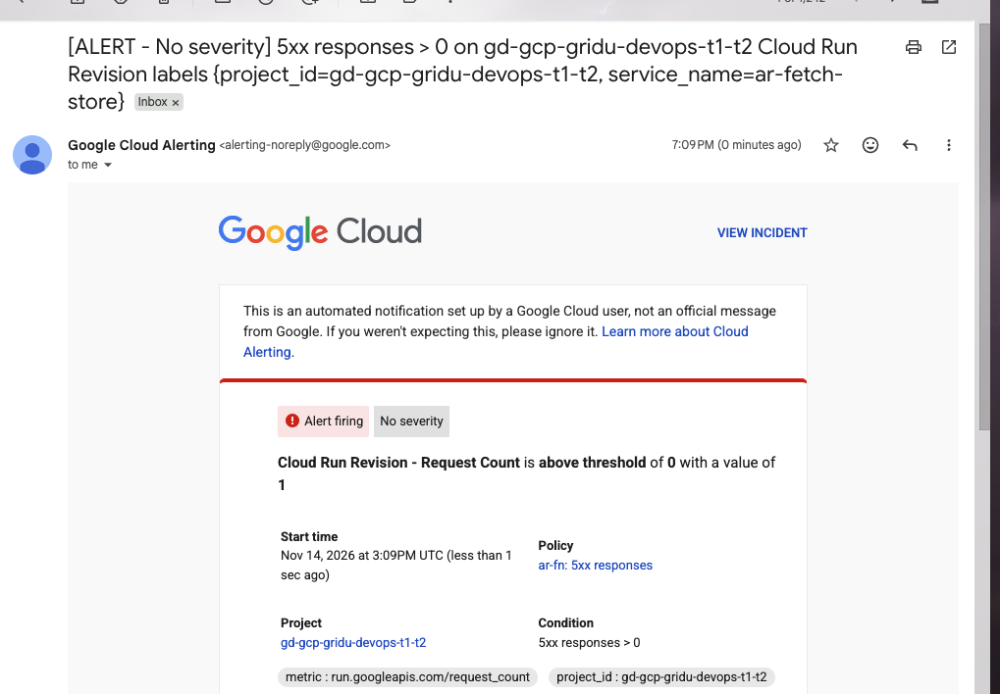
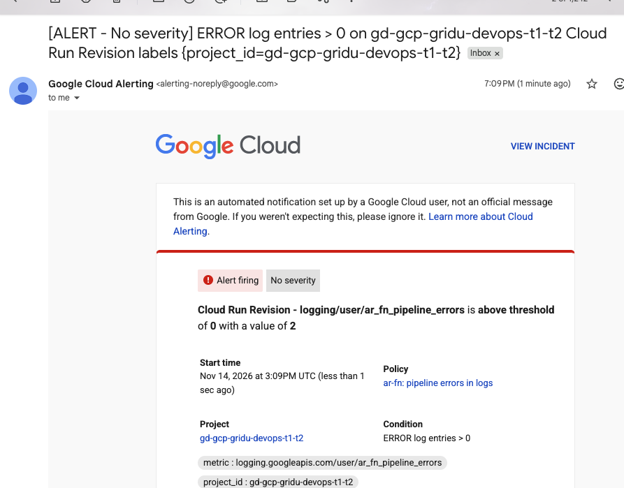

The dashboard and the log-errors policy:

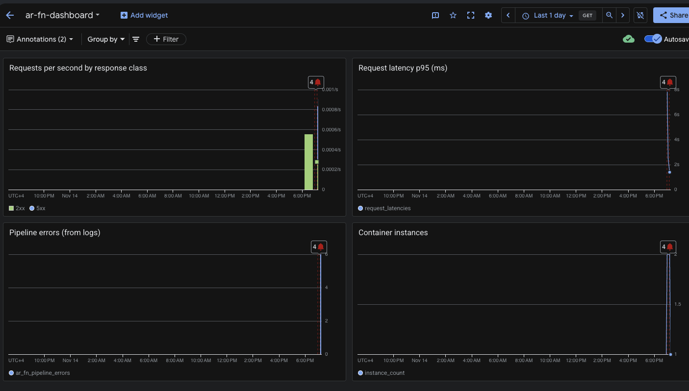
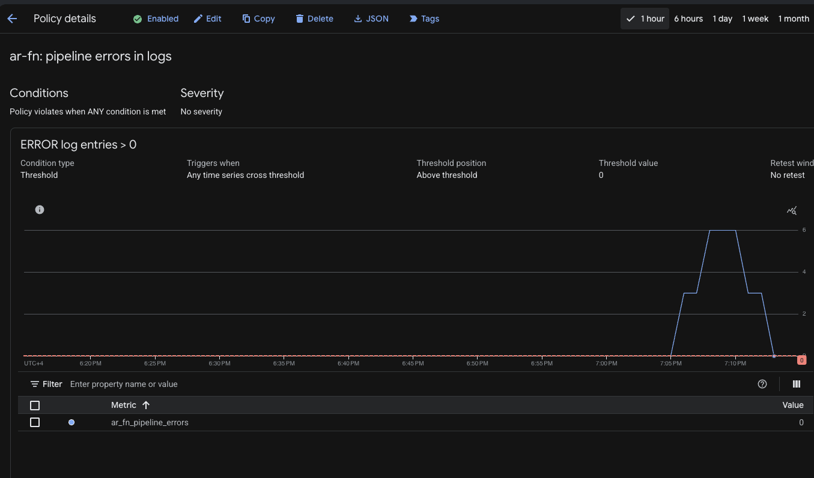

## Cleanup

```bash
python destroy.py
```

Type `delete` to confirm. Add `--keep-database` to keep the Firestore data. It removes the function, alert policies, channel, dashboard, log metric, bucket, IAM binding, service account and database.

## Troubleshooting

- **Build permission error on first deploy:** Cloud Build's service account may lack a role (usually `roles/cloudbuild.builds.builder`). Someone with IAM rights grants it, then re-run.
- **`PERMISSION_DENIED` on setIamPolicy:** deploy prints the admin command to run and carries on. Use `--runtime-sa EMAIL` to run as an existing service account.
- **Permission denied creating the database:** needs `roles/datastore.owner` or similar.
- **Alerts don't fire:** they need a few minutes of data, run the 502 call a few more times.
